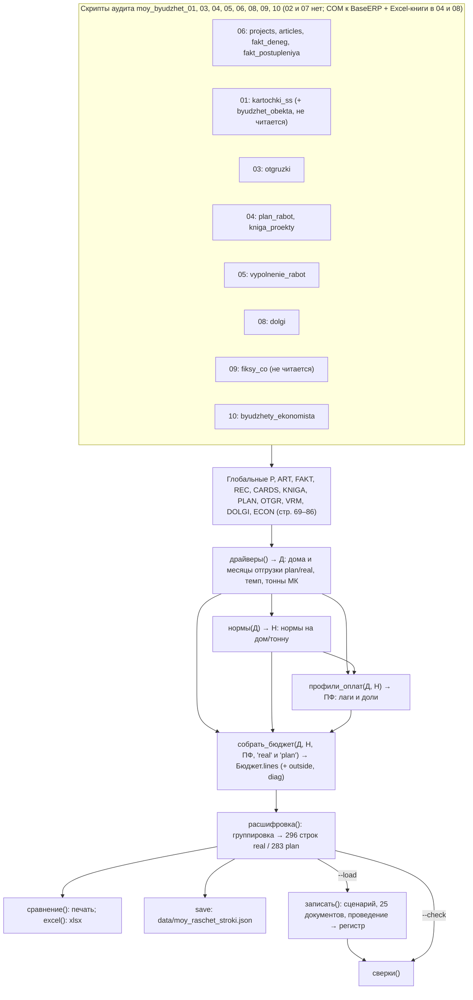

# 02. Алгоритм расчёта сценария 00009: шаг за шагом

Документ для ИИ в новой сессии. Здесь описано, как код `moy_byudzhet_raschet_2026-10.py` превращает снимки JSON
в 296 строк сценария «Бюджет (октябрь-декабрь 2026) - мой расчет» (код 00009). Описана **версия v2** (сценарий
перезагружен 02.10.2026 вечером, сверки OK). Что изменилось против v1 (302 строки) и почему, с числами «было → стало», —
в `11_ПРИМЕНЕННЫЕ_ИСПРАВЛЕНИЯ_v2.md` (эта же папка). Почему выбраны именно эти правила
и какие варианты отброшены, см. в `00_ИСТОРИЯ_И_РЕШЕНИЯ_СЕССИИ.md` (эта же папка). Методика изложена в
`C:\Configuration_downloads\BASERP25\_Rarzrabotki\notebook\knowledge_ПредварительныйРасчет_БюджетированияИ_PL\07_moy_metod_raschetnogo_byudzheta.md`,
аудит данных — в `…\06_audit_dannyh_moy_byudzhet.md`, исследование методик — в `…\05_metodiki_byudzhetirovaniya.md`.

Ссылки вида `стр. N` указывают на строки расчётчика
`C:\Configuration_downloads\BASERP25\_Rarzrabotki\Python\test\moy_byudzhet_raschet_2026-10.py` (1003 строки, v2;
в v1 было 980 — номера строк сдвинулись, все ссылки ниже даны по v2).
Ссылки `common:N` указывают на `…\Python\test\moy_byudzhet_common.py` (168 строк).

## 0. Насколько можно доверять этому описанию

Проверки выполнены 02.10.2026: днём для v1, вечером повторены для v2. В ходе проверок сам расчётчик (`__main__`)
**не запускался**. Результат v2 получен прогоном с `--load`, который делали до проверки, а не во время неё.

1. v1: копия расчётчика импортирована как модуль во временную папку, `save()` и `conn()` заблокированы. Затем по очереди
   вызваны `драйверы() → нормы() → профили_оплат() → собрать_бюджет("real"/"plan") → расшифровка()`. Результат
   **совпал** с тогдашним `data\moy_raschet_stroki.json` по полям `proj, month, art, vid, src, sum, text`: 302 строки
   `real` и 289 строк `plan`. Отсюда вывод: функции детерминированы. v2: числа взяты из нового
   `data\moy_raschet_stroki.json` (`stamp` «02.10.2026 18:38», выход прогона v2 с `--load`), в нём 296 строк `real`
   и 283 строки `plan`, и пересчитаны по нему Python-скриптом. Промежуточных величин в JSON нет (база и ставки
   калибровки ФА, факт УТ-001042, колонка факта сравнения). Их пересчитали повтором формул кода по `fakt_deneg.json`,
   и они совпали с `11_ПРИМЕНЕННЫЕ_ИСПРАВЛЕНИЯ_v2.md`.
2. База 1С проверена только чтением, через COM (v2). Сценарий 00009 содержит 25 документов `А_ПредварительныйБюджет`
   с номерами 00000000053…00000000077. Все проведены, пометок на удаление нет, в шапке `ПроцентКомиссииФА = 14.12`
   (в v1 было 8.33), `ПроцентПрочихНалогов = 0`, `ВидВерсии = Первичный`. В ТЧ 296 строк на сумму 79 933 404,69
   (в v1 было 302 строки на 88 788 581,10). Регистр `А_ПредварительныйБюджетНаМесяц`: 34 075 357,43 (124 записи),
   22 753 957,14 (89) и 23 104 090,12 (83). На каждую строку ТЧ приходится одна запись регистра.
3. Файл расчётчика в основном каталоге и в worktree `budget-calc-oct-dec-2026-20c998` одинаковый (v2, 1003 строки).

## 1. Файлы, константы, входы

### 1.1. Константы расчётчика

| Что | Где | Значение |
|---|---|---|
| Имя сценария | стр. 20 | `SCENARIO = "Бюджет (октябрь-декабрь 2026) - мой расчет"` (поиск и создание идут по **наименованию**, код 00009 1С присвоила сама) |
| Горизонт | стр. 21–22 | `МЕСЯЦЫ = ["2026-10","2026-11","2026-12"]`, `ПЕРВЫЙ = "2026-10"`, `ПОСЛЕДНИЙ = "2026-12"` (месяц хранится строкой `YYYY-MM`) |
| Ключ записи | стр. 23 | `LOAD = "--load" in sys.argv` |
| Виды оплаты | стр. 27 | `БН = "Безналичные"`, `НАЛ = "Наличные"` (это строковые представления `Перечисление.ТипыДенежныхСредств`) |
| Источники строк | стр. 28 | `РАСЧЕТ = "РасчетПоСС"`, `ФИКС = "ФиксИзБюджета"` (не используется ни в одной строке), `ВРУЧНУЮ = "Вручную"` |
| Статьи «оплачено ЗП» | стр. 29 | `ЗП_СТАТЬИ` = УТ-001075, 001076, 001178, 001136, 001135, 001206, 001207, 001208 |
| Банковская ЗП ЦО | стр. 30–31 | `ЗП_БАНК` = УТ-001075, 001076, 001078, 001079, 001171, 001172, 001175, 001177, 001178, 001188, 001206, 001207, 001208 |
| Финпомощь и прочее финансирование | стр. 32–34 | `ФИН_ПОМОЩЬ` = УТ-001181, УТ-001195, УТ-001144, УТ-001149, УТ-001150, УТ-001056, УТ-001059 (в v1 — только первые две; на 00009 расширение влияет на 0,00: в «Производстве» 2026 этих статей нет) |
| Пара финагента | стр. 35 | `ПАРА_ФА` = УТ-001082 (поступление от ФА, нал), УТ-001096 (оплата ФА, безнал) |
| Внутренние обороты (v2) | стр. 36–40 | `ВНУТР` = УТ-001042 «Внутригрупповые затраты», УТ-001163 (внутригрупповые доходы). Исключаются из ЦО (7.5), из базы калибровки ФА и банка (6) и из колонки факта в сравнении (9) |
| Доп. заказы УВБК ООН (v2) | стр. 41–43 | `ДОП_ЗАКАЗЫ`: ООН 2026 — 17.09 1 728 305,40 (PO145522: септики, ґрунт, доставка, автокран); ООН Админ — 11.09 856 450,66 (PO144605: кран і доставка модулів). Не учитываются в «получено за дома» ограничителя (7.1 г) и в выборке `p20` (6) |
| Транзит, финансирование | common:23–24 | `ТРАНЗИТ` = УТ-001210, 001211; `ФИНАНСИРОВАНИЕ` = УТ-001201, 001202, 001082, 001096 |
| Корень производства | common:16 | `ROOT_CODE = "0Ц-000004"` («Производство», его ЦО) |

### 1.2. Вспомогательные функции

- `сдвиг(м, k)` (стр. 46–52) — сдвигает месяц `YYYY-MM` на k месяцев с переходом через год.
- `мес(м)` (стр. 55) — украинское имя месяца из `УКР_МЕС` (стр. 25–26), используется только в текстах.
- `ч(x)` = `fmt(x, 2)` (стр. 59, common:87–88) — формат `1 234 567,89`: разделитель тысяч — обычный пробел, десятичная запятая.
- `пр(x, d)` (стр. 63–65) — доля в виде «16,7 %».
- `окр(x)` (common:82–84) — `Decimal(str(x)).quantize(0.01, ROUND_HALF_UP)`. Работает как колонка 1С «Число 15,2».
- `факт(проект, коды, с, по, вид)` (стр. 89–96) — сумма со знаком по `FAKT["rows"]` с отбором `projname`,
  `month ∈ [с, по]` (по умолчанию `2025-01…2026-09`), `art ∈ коды`, `type`. Расход в факте отрицательный, поэтому
  «оплачено» везде считается как `−факт(...)`.
- `книга(проект, имя_строки)` (стр. 99–103) — строка книги экономиста с `level == 2`, у которой имя начинается
  с `имя_строки` (без учёта регистра). Возвращает `{ss, fact, budget}`; если строки нет — нули.

### 1.3. Какие снимки читает расчётчик

Папка снимков: `C:\Configuration_downloads\BASERP25\_Rarzrabotki\Бюджет прогноз\Бюджет октябрь 2026\Мой расчет\data\`.
Загрузка выполняется на уровне модуля, стр. 69–86.

| Снимок | Переменная | Пишет скрипт | `stamp` / время файла (02.10.2026) | Что из него используется |
|---|---|---|---|---|
| `projects.json` | `P`, `ПРОЕКТ` (имя → УИД, `setdefault`), `ROOT` | 06 | stamp нет; файл 12:54 | имена проектов, УИД подразделений для записи |
| `articles.json` | `ART` (код → статья; только не группа, не запрещённая ветка УТ-000965, не помеченная — 147 статей) | 06 | stamp нет; файл 12:54 | `type` (Приход/Расход), `name` |
| `fakt_deneg.json` | `FAKT` (2 899 строк проект × статья × вид × месяц, со знаком); `СНИМОК = FAKT["stamp"]` (стр. 86) | 06 | **12:55** | оплачено, ЦО, калибровка ФА и МК, колонка факта в сравнении |
| `fakt_postupleniya.json` | `REC` (1 148 поступлений по дням, без транзита и финансирования) | 06 | 12:55 | профили IRC и УВБК ООН, оплата Кривого Рога в сентябре, проверка платежей `ДОП_ЗАКАЗЫ` (`assert`, стр. 464) |
| `kartochki_ss.json` | `CARDS` (код карточки → нормы; 7 карточек) | 01 | 12:58 | цена дома, материалы, ЗП «чол/год», раздел IX, прочие работы |
| `kniga_proekty.json` | `KNIGA` | 04 | stamp нет; файл 13:11 | СС/факт договора («Поступление от Заказчика»), нормы санвузла и ООН 2026 |
| `plan_rabot.json` | `PLAN` (`md` — дома, `mk` — тонны) | 04 | stamp нет; файл 13:11 | план отгрузок, тонны МК, факт тонн сентября |
| `otgruzki.json` | `OTGR` (110 строк документов `А_ОтгрузкаПродукции`: 9 с домами, 8 актов МК с тоннами, 93 рейса и экспедирование) | 03 | 13:19 | даты отгрузок домов, тонны и рейсы МК |
| `vypolnenie_rabot.json` | `VRM` (`ev` — 39 строк EV-часов; `houses` — 17 домов с `plan_h`/`done_h`) | 05 | 13:19 | темп цеха, готовность домов |
| `dolgi.json` | `DOLGI` (`erp` — 211, `kniga` — 153 строки «Долги Коррект»); стр. 83–84 заменяют NBSP в `cfo` | 08 | 13:02 | долги поставщикам, дебиторка Оріль |
| `byudzhety_ekonomista.json` | `ECON` (561 строка 00007/00008) | 10 | 12:56 | разовые и финансирование из 00008, хвост Глобино, сравнение |

Снимки сняты не одновременно, а в 12:54–13:19. Время `stamp` (строка «ДД.ММ.ГГГГ ЧЧ:ММ» внутри JSON) есть только
у части файлов. У остальных указано время изменения файла. `СНИМОК` (стр. 86), который попадает в комментарий
документа и в Excel («знімок 02.10.2026 12:55»), — это `stamp` **только факта Казны** (`fakt_deneg.json`), а не
всех снимков. Если перезапустить часть скриптов аудита, сравните время файлов в `data\`, чтобы понять, какие
снимки старше.

`byudzhet_obekta.json` (stamp 12:58) и `fiksy_co.json` (stamp 13:04) расчётчик **не читает**. Их пишут скрипты 01
и 09 только для аудита: фиксы ЦО устарели, бюджет объекта не нужен.

## 2. Схема потоков данных



Скрипты аудита (все в `C:\Configuration_downloads\BASERP25\_Rarzrabotki\Python\test\`): `moy_byudzhet_01`, `03`,
`04`, `05`, `06`, `08`, `09`, `10`. Скриптов **02 и 07 не существует**, искать их не нужно. Запись «01…10» в
docstring расчётчика (стр. 8) — это диапазон номеров, а не полный список.
Порядок перезапуска: сначала 06 (пишет `projects.json` и `articles.json` для расчётчика и `fakt_deneg.json` для
скрипта 09), затем 01, 03, 04, 05, 08, 10 в любом порядке, 09 — только после 06. Excel нужен двум скриптам. Книги лежат в
`C:\Configuration_downloads\BASERP25\_Rarzrabotki\Бюджет прогноз\Бюджет октябрь 2026\`:

- скрипт 04 (к 1С не подключается) читает `План  робіт-на Квартал_Жовтень  грудень.xlsx` (в имени **двойные
  пробелы**) и книгу экономиста `Принятый бюджет\Бюджет_Жовтень26-Грудень26.xlsx`;
- скрипт 08 читает `Долги Коррект.xlsx` (лист «Долги»).

Скрипт 10 Excel не читает: он берёт бюджеты 00007/00008 из регистра `А_ПредварительныйБюджетНаМесяц`.
Порядок, листы, колонки и зашитые границы каждого скрипта описаны в `09_КАК_ПЕРЕСЧИТАТЬ_И_ИЗМЕНИТЬ.md`, раздел 3
«Обновление снимков» (эта же папка).

## 3. Порядок вызовов в `__main__` (стр. 958–1003)

1. `Д = драйверы()`, `Н = нормы(Д)`, `ПФ = профили_оплат(Д, Н)` (стр. 960–962). `ПФ` становится **глобальной**
   переменной, и `записать()` читает её на стр. 832 и 835.
2. Печать параметров (стр. 963–974).
3. `Б_р = собрать_бюджет(Д, Н, ПФ, "real")` и `Б_п = …("plan")` (стр. 975–976). Печать `Б_р.diag`.
4. `СТР = расшифровка(Б_р)`, `СТР_П = расшифровка(Б_п)` (стр. 979–980). Итоги по месяцам. Печать «за горизонтом»
   (стр. 986–989) — **единственное место, где виден `outside`**.
5. `сравнение(СТР, СТР_П)` (стр. 990) печатает таблицы. `excel(...)` (стр. 991) пишет xlsx.
   `save("moy_raschet_stroki.json", {"stamp", "real", "plan"})` (стр. 992).
6. Если передан `--load` или `--check` — запись и сверки (стр. 993–1003). Код выхода 1, если сверки нашли ошибки.

## 4. Шаг 1. `драйверы()` (стр. 107–218): какие дома и в каком месяце уезжают

На выходе словарь `Д`:

- `ev_month[(проект, месяц)]` — EV-часы;
- `shipped[проект]` — даты отгруженных домов;
- `houses[проект]` — список домов вида `{id, card, plan_h, done_h, thr, shipped, ship_real, ship_plan, need_h}`;
- `plan[проект]` и `real[проект]` — `Counter` по месяцам отгрузки неотгруженных домов;
- `mk[проект]` — `{plan: {месяц: тонны}, sep_fact}`;
- `temp`, `thr_adm`.

1. **EV-часы** (стр. 116–117) — сумма `VRM["ev"].hours` по (проект, месяц). IRC: 07 — 1 700,17, 08 — 1 322,72,
   09 — 1 139,09. ООН Админ: 08 — 1 153,33, 09 — 1 554,67. Суммы по цеху (1 700 / 2 476 / 2 694) приведены в 07.
2. **Факт отгрузок домов** (стр. 124–128): по каждой строке `OTGR` с `houses > 0` дата повторяется `round(houses)` раз.
   IRC: 03.08, 03.08, 05.08, 10.08, 18.08, 31.08 (это IRC 15 м), 21.09, 29.09 (IRC 30 м №1–2). ООН Админ: 17.09.
3. **`подомово(проект, карта, порог, темп, план_мес)`** (стр. 130–167):
   - дома карточки `карта` из `VRM["houses"]` сортируются по номеру из имени (`номер()` берёт число после «№»);
   - `n_ship` = число отгрузок проекта с датой ≥ 01.09. Первые `n_ship` домов по номеру помечаются `shipped`,
     для них `ship_real = "2026-09"`;
   - `thr = plan_h × порог`, `need = max(0, thr − done_h)`;
   - **реалистичный график — FIFO по темпу** (стр. 140–154). Ёмкость месяца равна `темп`. Каждый дом выбирает
     свои `need` часов из остатка ёмкости, недостающее переходит на следующий месяц. `ship_real` — месяц,
     в который пришёлся последний час дома (`сдвиг(ПЕРВЫЙ, мес_i)`);
   - **плановый график** (стр. 156–166): неотгруженные дома по порядку номеров раскладываются по месяцам
     `план_мес` — это план «План робіт» за месяцы ≥ октября, функция `план_проекта()`, стр. 169–173.
     Дома, которым не хватило места в плане, получают `"2027-01"`.
4. **Темп** (стр. 175–177) — EV-часы **сентября** по проекту: IRC — 1 139,094, ООН Админ — 1 554,666.
5. **IRC** (стр. 178): карточка 000000009 (IRC 30 м), порог 1,0, план `{окт: 4, ноя: 1}`. Расчёт FIFO по 1 139,09 ч/мес:

   | Дом | plan_h | done_h на 30.09 | need | ship_real | ship_plan |
   |---|---|---|---|---|---|
   | №1, №2 | 639,99 | 639,99 | — | 2026-09 (отгружены) | — |
   | №3 | 639,99 | 199,19 | 440,80 | 2026-10 (остаток ёмкости 698,29) | 2026-10 |
   | №4 | 639,99 | 45,25 | 594,74 | 2026-10 (остаток 103,56) | 2026-10 |
   | №5 | 639,99 | 45,25 | 594,74 | 2026-11 (103,56 ч в окт + 491,18 ч в ноя) | 2026-10 |
   | №6 | 639,99 | 45,25 | 594,74 | 2026-11 (остаток 53,18) | 2026-10 |
   | №7 | 639,99 | 45,25 | 594,74 | 2026-12 (53,18 ч в ноя + 541,56 ч в дек) | 2026-11 |

6. **ООН Админ** (стр. 180–182): карточка 000000011. Порог `thr_adm = done_h / plan_h` дома №1 = 1 433,333 / 2 150 = 0,6667,
   план `{окт: 2, ноя: 1}`, темп 1 554,67. №2 (done 1 194,67, need 238,67) уходит в октябре. №3 (done 40, need 1 393,33)
   набирает 1 316,0 ч в октябре и 77,33 ч в ноябре, поэтому уходит в ноябре. №4 тоже в ноябре.
   ship_plan: №2 и №3 — октябрь, №4 — ноябрь.
7. **ООН 2026** (стр. 184–198): в ВРМ проекта нет. Реалистичный график **зашит в код**:
   `реал_оон = {"2026-10": 2, "2026-11": 3, "2026-12": 3, "2027-01": 2}` (обоснование — в 00, п. 1).
   ship_plan берётся из «План робіт» `{окт: 2, ноя: 5, дек: 3}`. У всех 10 домов `plan_h = done_h = thr = 0`, карточка 000000010.
8. **Санвузол** (стр. 199–200): один дом, `ship_real = ship_plan = "2026-11"`, зашито в код.
9. **МК** (стр. 202–214). `тонны(ключ)` суммирует `plan` по строкам `PLAN["mk"]`, у которых `item` начинается
   с ключа, за месяцы ≥ октября. `тонны_факт` даёт сентябрьский `fact`.
   Каменец («Камянец подольский»): `{окт: 48,463, дек: 18,14}`, факт сентября 39,677.
   Кривий ріг (КМ1 + КМ2): `{окт: 4,776 + 1,878 = 6,654}`, факт сентября 0,6.
   Строка «Камянец ТХ» (тонн нет, «5 наименований») в расчёт не попадает.
   План МК совпадает с реалистичным графиком.
10. Счётчики (стр. 215–217). Реалистичный график: IRC 2/2/1, Админ 1/2/0, ООН 2026 2/3/3 (+2 в январе),
    санвузол 0/1/0, всего **5/8/4**. План: 4/1/0, 2/1/0, 2/5/3, 0/1/0, всего **8/8/3**.

## 5. Шаг 2. `нормы(Д)` (стр. 222–274): сколько стоит дом или тонна

Вложенная функция `опр(c)` (стр. 228–233) суммирует раздел IX карточки (`c["opr"]`) по статье. Дубли карточки 000000011
уже свёрнуты в скрипте 01 через `МАКСИМУМ` по (статья, наименование). Автокран и экскаватор при этом складываются в УТ-001189.

| Проект | bom (материалы/дом) | labor (ЗП Ф2/дом) | opr (раздел IX/дом) | works (прочие работы/дом) | price | houses_total |
|---|---|---|---|---|---|---|
| МД IRC 2026 (стр. 234–235) | 1 009 864,74 (СС 000000009) | 260 630,03 | УТ-001046 8 000; УТ-001066 52 490; УТ-001069 2 000; УТ-001075 2 000; УТ-001116 15 000; УТ-001189 27 000 | УТ-001075 6 500 | 1 755 600,00 | (000000008 × 6, 000000009 × 7) |
| МД ООН Админ (стр. 236–241) | 1 634 453,54 | 642 060,00 | УТ-001046 6 000; **УТ-001066 177 865,25** (факт сентября, вместо 80 000 по карточке); УТ-001068 16 250; УТ-001069 10 000; УТ-001075 15 000; УТ-001116 7 500; УТ-001189 11 000 | УТ-001068 5 200; УТ-001075 7 500 | 3 156 391,75 | (000000011 × 4) |
| МД ООН 2026 (стр. 242–249) | 994 473,85 | **225 700** = книга «Зарплата производственного» СС 2 257 000 / 10 | УТ-001046 10 400; УТ-001066 35 200; УТ-001116 5 000; УТ-001189 9 000; **УТ-001068 33 500** = книга «Услуги сторонних» 335 000 / 10 (заменяет «креслення» 4 500) | — | 1 590 044,82 | (000000010 × 10) |
| МХП санітарний вузол (стр. 250–253) | 207 001 (книга «Строительные материалы» СС) | 85 300 (книга) | УТ-001066 18 000 (книга «Транспортные») | — | 381 600 (книга «Поступление») | `None` |

Транспорт ООН Админ (стр. 237–239): `−факт("МД ООН Админ", {"УТ-001066"}, "2026-09", "2026-09")` = 177 865,25.
Значение также сохраняется в `Н["thr_note_adm"]` и `transport_fact`.
Ключ УТ-001068 у ООН 2026 удаляется и добавляется заново (стр. 244–245). Поэтому в документах ООН 2026 строка
«Послуги» идёт после «Оренда техніки».

**Ставки МК** (стр. 255–272):

| | Каменец Цемент | Кривий ріг |
|---|---|---|
| Цена, грн/т | книга «Поступление» СС 3 007 592,00 / 87,43 = **34 400,00** | **32 900** (зашито, стр. 270) |
| ЗП, грн/т | `−факт(ЗП_СТАТЬИ, 08–09)` 353 288,42 / факт тонн сентября 39,677 = **8 904,11** | `−факт(ЗП_СТАТЬИ, 07–08)` 1 499 765,30 / тонны отгрузок 07–08 (64,720 + 37,753 = 102,473) = **14 635,71** |
| Логистика, грн/т | рейсы сентября с «МК» в `order`: 3 × 43 200 / 39,677 = **3 266,38** (рейс 29.09 «Доставка метала» за 1 500 не попал — в названии нет «МК») | рейсы июля, цех ≠ «Цех металлоконструкций» и «МК» в `order`: 4 × 36 000 / 64,720 = **2 224,97** |
| МШП, услуги, грн/т | 4 125,08 и 1 453,27 (зашиты, ставки экономиста) | те же |

## 6. Шаг 3. `профили_оплат(Д, Н)` (стр. 278–319): ритм денег

| Ключ `ПФ` | Как считается | Значение |
|---|---|---|
| `irc` (стр. 283–294) | 6 отгрузок IRC до 01.09 сопоставляются FIFO с «событиями оплаты». Каждый платёж `REC` (МД IRC 2026, УТ-001146) разбивается на `round(сумма / 1 232 000)` событий (цена IRC 15 м): 18.08 — 1 252 966,40 → 1; 15.09 — 3 761 186,80 → 3; 16.09 — 1 253 716,80 → 1; 22.09 — 1 248 800,00 → 1 | лаги [15, 43, 41, 36, 29, 22] дней, `mean` = 31, `same` = 1/6 = 16,67 % (оплата в месяце отгрузки только в паре 03.08 → 18.08), `next` = 83,33 %, `n` = 6 |
| `un` (стр. 296–303) | отгрузка ООН Админ 17.09, первое поступление после неё без платежей `ДОП_ЗАКАЗЫ` (фильтр с v2, стр. 297–299; доп. заказ Админ 11.09 и так раньше отгрузки, поэтому на снимке фильтр ничего не меняет) — 29.09, 631 278,39 | `p20 = round(631 278,39 / 3 156 391,75, 4)` = 0,2; `lag20_days` = 12; `same20 = max(0, 1 − 12/30)` = 0,6; `p50` = 0,5, `lag50` = 2 (зашиты). `adv` = 0,3 (стр. 303) **нигде не используется**: «30 %» в тексте основы — литерал на стр. 499. Если поменять `adv`, ничего не изменится |
| `fa` (стр. 304–316) | факт 2026-01…2026-09 по всем подразделениям под корнем. `commission = −Σ` УТ-001097; `bank = −Σ` УТ-001063 НАЛ; `cash = −Σ` наличных расходных строк без транзита, финансирования, финпомощи, **`ВНУТР`** (УТ-001042, УТ-001163; с v2, стр. 305), УТ-001097, УТ-001063 и строк без статьи | cash **13 288 453,00**; commission 1 875 839,89 → `rate` 0,141163 (**14,12 %**, близко к 15 % экономиста); bank 210 250,00 → `bank_rate` 0,015822 (**1,58 %**). В v1 в базу попадал дубль ЗП Ф2 на УТ-001042 (9 224 815,00 наличных за 01–09): cash 22 513 268,00, ставки 8,33 % и 0,93 % были занижены |
| `mat_lead` (стр. 317) | константа | 1 (материалы оплачиваются за месяц до отгрузки) |
| `labor_kernel` (стр. 318) | константа | `{-1: 0,45, 0: 0,55}` — ядро ЗП: 45 % в месяц до отгрузки, 55 % в месяц отгрузки |

## 7. Шаг 4. `собрать_бюджет(д, н, пф, сценарий)` (стр. 344–639)

### 7.0. Класс `Бюджет` и метод `add` (стр. 323–341): общие правила для всех сумм

Каждая сумма бюджета проходит через `б.add(проект, м, ст, вид, сумма, источник, текст, основа="")`:

```text
сумма = окр(сумма)                       # 1) ROUND_HALF_UP до копейки — первым действием
if |сумма| < 0.005: return                # 2) нулевые части отбрасываются (до сдвига месяца)
if м < "2026-10": м = "2026-10"           # 3) всё, что «должно было быть» раньше октября, — догоняющая оплата в октябре
if м > "2026-12":                         # 4) за горизонтом: копится в outside[(проект, статья)], месяц теряется
    outside[(проект, ст)] += сумма; return
assert ст in ART                          # 5) статья обязана быть в справочнике (проверка после пункта 4)
lines.append({proj, month, art, vid, sum, src, text = f"{текст} = {ч(сумма)}", basis = основа})
```

- Итог каждой части дописывается в текст как «= N,NN». На этом держатся сверка расшифровки и формат группы
  (см. шаг 5).
- `основа` (basis) — общая «Підстава» строки: метод, профиль, источник ставки. После группировки повторы удаляются.
- `diag` (стр. 328) — диагностика ЗП. Печатается в `main`, в документы не попадает.
- В сценарии `real` было 432 вызова `add` (в v1 — 438: в v2 ушли 6 вызовов ЦО по УТ-001042 НАЛ и БН, см. 7.5).
  Из них 1 отброшен как ноль: поступление Каменца за декабрьские 18,14 т (январь 2027), где остаток договора уже
  исчерпан. Ещё 25 ушли за горизонт. Осталось 406 частей, после группировки — 296 строк (в v1 — 412 и 302). В октябрь сдвинуто 7 частей на 1 306 169,91 (см. 7.1).
- Все суммы положительные (минимум — 280,00), направление задаёт тип статьи `ART[ст]["type"]`. Так же хранит
  данные регистр: сумма всегда положительная, знак определяется `А_ТипПоказателя` статьи.

Сценарий `"real"` использует `h["ship_real"]`, `"plan"` — `h["ship_plan"]` (`ship = lambda h: h["ship_" + сценарий]`,
стр. 353). В 1С записывается только `real`.

### 7.1. МД по домам: цикл по IRC → ООН Админ → ООН 2026 → санвузол (стр. 349–515)

`будущие` (стр. 354) — неотгруженные дома, отсортированные по (месяц отгрузки, номер).

**а) Материалы, УТ-001067, БН, `РасчетПоСС`** (стр. 355–390). Метод «остатка к оплате»:

```text
норма_проекта = Σ CARDS[c].materials × n по houses_total      (санвузол: bom из книги)
оплачено      = −факт(проект, {УТ-001067})                      (2025-01…2026-09)
покрытие      = оплачено − (норма_проекта − bom × len(будущие)) # оплачено сверх нормы уже отгруженных домов
для h в будущие (FIFO):  часть = bom − min(покрытие, bom);  покрытие −= взятое
    непокрытая часть → месяц сдвиг(ship(h), −mat_lead)          # за 1 мес. до отгрузки
долг_мат = Σ debt «Долги Коррект», cfo = проект, article = «Строительные материалы»
перенос  = max(0, min(долг_мат, Σ план) − Σ план за месяцы ≤ октября)   # октябрь не меньше долга
```

Перенос (стр. 374–389) снимает часть поздних месяцев и добавляет её в октябрь отдельной частью с текстом
«перенесено на жовтень у межах боргу». **На этом снимке перенос = 0 во всех проектах**: октябрь и так больше долга.
Кредиторка за материалы МД сверху не прибавляется, потому что уже сидит внутри остатка (см. 7.4).

| Проект (real) | Норма проекта | Оплачено | Будущих | Покрытие | Долг мат. | Октябрь | Ноябрь | Декабрь |
|---|---|---|---|---|---|---|---|---|
| МД IRC 2026 | 6 × 704 612,01 + 7 × 1 009 864,74 = 11 296 725,24 | 7 555 928,55 | 5 | 1 308 527,01 (закрывает №3 и 298 662,27 от №4) | 1 604 157,13 | 2 730 931,95 (остаток №4 711 202,47 перенесён из сентября + №5, №6) | 1 009 864,74 (№7) | — |
| МД ООН Админ | 4 × 1 634 453,54 = 6 537 814,16 | 3 723 906,89 | 3 | 2 089 453,35 (№2 полностью + 454 999,81 от №3) | 638 052,08 | 2 813 907,27 (остаток №3 1 179 453,73 + №4) | — | — |
| МД ООН 2026 | 10 × 994 473,85 = 9 944 738,50 | 1 818 954,02 | 10 | 1 818 954,02 (№1 + 824 480,17 от №2) | 206 646,63 | 3 153 415,23 (остаток №2 169 993,68 перенесён из сентября + №3–5) | 2 983 421,55 (№6–8) | 1 988 947,70 (№9–10, отгрузка в январе) |
| Санвузол | 207 001,00 | 0 | 1 | 0 | 0 | 207 001,00 | — | — |
| **Итого** | | | | | | **8 905 255,45** | **3 993 286,29** | **1 988 947,70** |

Если у части покрыта не вся норма, к заголовку добавляется фраза «частину вже сплачено (норма проєкту … = …,
сплачено … — факт Казни)» (стр. 385–386).

**б) ЗП производства (Ф2), УТ-001075, НАЛ, `РасчетПоСС`** (стр. 391–429).

Для IRC и ООН Админ (данные ВРМ есть):

```text
ставка   = labor / дома[0].plan_h          # IRC 260 630,03 / 639,99 = 407,24 грн/ч; Админ 642 060,00 / 2 150 = 298,63
для каждого дома h (включая отгруженные):
  цех    = max(0, thr − done_h) × ставка   # часы до готовности к отгрузке
  объект = max(0, plan_h − max(thr, done_h)) × ставка   # доделки на объекте (у IRC порог 100 % → 0)
  будущее += цех + объект
  отгружен: объект → октябрь («доробки на об'єкті»)
  иначе:   цех × 0,45 → сдвиг(ship, −1);  цех × 0,55 → ship;  объект → сдвиг(ship, +1)
норма_зп = Σ labor_f2 × n по houses_total;  оплачено_зп = −факт(проект, ЗП_СТАТЬИ)
долг_зп  = норма_зп − оплачено_зп − будущее  → октябрь («за вже виконані роботи»), если > 0,5
```

| | норма_зп | оплачено | будущее | долг (октябрь) |
|---|---|---|---|---|
| IRC | 6 × 182 820,02 + 7 × 260 630,03 = 2 921 330,33 | 1 403 307,12 | 1 148 314,76 | 369 708,45 |
| ООН Админ | 4 × 642 060 = 2 568 240,00 | 380 953,74 | 1 759 543,03 | 427 743,23 |

Доделки ООН Админ: (2 150 − 1 433,33) ч × 298,63 = 214 020,00 на каждый дом. Для №1 они идут в октябрь,
для №2 — в ноябрь, для №3 и №4 — в декабрь.

Для ООН 2026 и санвузла ВРМ нет (стр. 423–429): по каждому будущему дому `labor × 0,45` в месяц `сдвиг(ship, −1)`
и `labor × 0,55` в месяц `ship`. Долг не считается. ООН 2026 — 101 565,00 + 124 135,00 на дом,
санвузол — 38 385,00 (октябрь) + 46 915,00 (ноябрь).

Части «45 %» домов, отгружаемых в октябре, приходятся на сентябрь и сдвигаются в октябрь. Это IRC №3 (80 780,28)
и №4 (108 990,34), Админ №2 (32 073,14), ООН 2026 №1 и №2 (по 101 565,00).
ЗП домов ООН 2026 №9–10 за январь 2027 (2 × 124 135,00 = 248 270,00) уходит за горизонт.

**в) Накладные раздела IX и прочие работы** (стр. 430–456). Дома группируются по месяцу отгрузки `ship(h)`
**без сдвига**. Для каждой статьи `opr` с нормой > 0 добавляется `норма × n домов` (стр. 452):

- УТ-001116 «Приїзд робітників» пишется в статью **УТ-001133 «Топливо»**, как у экономиста (стр. 442);
- вид оплаты НАЛ только у УТ-001075 «Непередбачувана робота», остальные статьи — БН (стр. 443);
- текст источника (стр. 444–451): у Админ транспорта — «факт доставки буд. №1 у вересні 177 865,25 (негабарит;
  у картці СС 80 000)», у ООН 2026 услуг — `services_src`, у санвузла — «бюджет проєкту економіста (СС)»,
  у остальных — «СС <код>, розділ IX»;
- `works` (стр. 454–456): `норма × n`, вид БН, текст «Роботи підрядників (не «чол/год»)».

Важно: «Непередбачувана робота» (УТ-001075 НАЛ `РасчетПоСС`) при группировке **сливается в одну строку с ЗП Ф2**,
потому что ключ группировки у них общий. А работы подрядчиков УТ-001075 идут БН отдельной строкой.

**г) Поступления, УТ-001146, БН, `РасчетПоСС`** (стр. 457–515). Каждый проект собирает список `пост` из троек
(месяц, сумма, текст):

- **IRC** (стр. 473–484). Дома, отгруженные в сентябре (№1 — 21.09, №2 — 29.09), дают 100 % цены 1 755 600,00
  в октябре. Будущие дома дают `цена × same` (16,7 % = 292 600,00) в месяц отгрузки и `цена × next`
  (83,3 % = 1 463 000,00) в следующий. Итог: окт 4 096 400,00 / ноя 3 511 200,00 / дек 3 218 600,00,
  за горизонт — 1 463 000,00 (№7, январь).
- **ООН Админ и ООН 2026** (стр. 485–501), профиль `un`. Отгруженный дом (Админ №1) — `50 % × цена` через
  `lag50` = 2 мес. от сентября, то есть в ноябре. По каждому будущему дому: `цена × 0,2 × 0,6` в месяц отгрузки,
  `цена × 0,2 × 0,4` в следующий, `цена × 0,5` через +2 мес. Аванс 30 % уже получен и не планируется.
  - Админ: окт 378 767,01 (20 % × 60 % от №2) / ноя 2 588 241,24 (50 % №1 1 578 195,88 + 20 % × 40 % №2 252 511,34
    + 20 % × 60 % №3, №4 по 378 767,01) / дек 2 083 218,56 (50 % №2 + 20 % × 40 % №3, №4). За горизонтом
    3 156 391,76 (50 % №3 и №4).
  - ООН 2026: окт 381 610,76 / ноя 826 823,32 / дек 2 544 071,73. За горизонтом 7 377 807,99 (январь–март 2027).
- **Санвузол** (стр. 502–507): аванс 30 % (114 480,00) в октябре, 70 % (267 120,00) через месяц после отгрузки,
  то есть в декабре.
- **Ограничитель — остаток договора** (стр. 458–471 и 508–515). Для IRC и санвузла
  `остаток = книга(проект, "Поступление").ss − .fact`. Для УВБК ООН (проекты из `ДОП_ЗАКАЗЫ`, стр. 460–471) с v2 берётся
  остаток **основного заказа**: `цена × домов (houses_total) − (факт книги − оплаты отдельных заказов доп. услуг)`.
  Каждый платёж доп. заказа должен найтись в `REC` по дате и сумме, иначе `assert` (стр. 464) роняет расчёт.
  ООН 2026: 15 900 448,20 − (6 498 439,86 − 1 728 305,40) = **11 130 313,74**, получено за дома ровно 30 %
  (4 770 134,46). ООН Админ: 12 625 567,00 − (5 275 399,35 − 856 450,66) = **8 206 618,31**. В v1 остаток брался
  из книги (11 032 848,14 и 7 350 167,65), и в факт попадали оплаты доп. заказов PO145522 и PO144605.
  Дальше `всего = Σ пост` за месяцы ≤ декабря, `k = min(1, остаток / всего)` (если `всего > 0` и `остаток > 0`,
  иначе 1). Все части умножаются на `k`. При `k < 1` в основу дописывается «коефіцієнт …». На снимке
  **k = 1 у всех**: IRC 10 826 200,00 < 12 164 530,00; Админ 5 050 226,81 < 8 206 618,31; ООН 2026
  3 752 505,81 < 11 130 313,74; санвузол 381 600,00 = 381 600,00. Поэтому суммы IV кв. от правки v2 не изменились,
  поменялся только текст «Підстава». Поступления за горизонтом в `всего` не входят. При остатке ≤ 0 ограничение
  не действует (`k = 1`).
- Основа (`профиль_txt` + `остаток_txt`) становится общей «Підстава» строки поступлений. `остаток_txt` — это
  «залишок договору … (СС − факт, книга економиста)», а у УВБК ООН — «залишок основного замовлення … = ціна … × домів
  (…) − отримано за будинки … (факт … мінус оплати окремих замовлень дод. послуг PO…)».

### 7.2. МК по тоннам: Каменец Цемент, Кривий ріг (стр. 517–555)

Затраты считаются в месяц тонн плана (стр. 521–528) как `т × ставка`: ЗП УТ-001075 НАЛ, МШП УТ-001065 БН,
услуги УТ-001068 БН, логистика УТ-001066 БН.

- Каменец, октябрь (48,463 т): 431 519,94 / 199 913,75 / 70 429,82 / 158 298,38.
- Каменец, декабрь (18,14 т): 161 520,58 / 74 828,95 / 26 362,32 / 59 252,06.
- Кривий ріг, октябрь (6,654 т): 97 386,03 / 27 448,28 / 9 670,06 / 14 804,94.

Поступления:

- **Каменец** (стр. 530–543). `аванс = fact / ss` = 1 516 008 / 3 007 592 = 50,41 %,
  `на_т = 34 400 × (1 − аванс)` ≈ 17 060,3 грн/т. Ряды (месяц оплаты, тонны): (окт, 39,677 т сентября),
  (ноя, 48,463 т октября), (янв 2027, 18,14 т декабря). Каждая сумма равна
  `min(т × на_т, max(0, остаток − нарастающе))`, где остаток = 1 491 584,00.
  Получается окт 676 902,42, ноя 814 681,58 (урезано остатком договора, текст «тонни понад договір — потрібна
  додаткова угода»), январь 0 (отброшен в `add`). Всего ровно 1 491 584,00.
- **Кривий ріг** (стр. 544–555), без ограничителя по остатку:
  - октябрь — хвост за август `37,753 т × 32 900 − оплачено в сентябре 1 168 820,65` = 73 253,05
    плюс сентябрь `0,6 т × 32 900` = 19 740,00, всего 92 993,05;
  - ноябрь — `6,654 т × 32 900` = 218 916,60.

### 7.3. Хвосты договоров, `Вручную` (стр. 557–568)

Словарь `ХВОСТЫ`, одна сумма на проект, УТ-001146 БН:

| Проект | Месяц | Сумма | Откуда |
|---|---|---|---|
| МД МХП ОРІЛЬ | окт | 445 715,56 | `Σ DOLGI["erp"]` с `kind = "клиенты"` (ОРІЛЬ-ЛІДЕР, РасчетыСКлиентамиПоСрокам на 01.10) |
| МД Кернел Кухня | ноя (зашито) | 796 388,90 | книга: СС 12 974 914,47 − факт 12 178 525,57 |
| МД ООН 2025 | окт | 1 154 400,18 | `0,6 × 1 924 000,30` (цена зашита; кратность платежей ООН 2025 видна в `REC`) |
| МК Глобино | окт | 32 005,12 | первая строка `ECON` 00008 (МК Глобино, УТ-001146) **без отбора по месяцу**; в 00008 такая строка одна, октябрьская |

МК Чорноморськ в хвостах нет: договор переплачен (остаток −8 691,89).

### 7.4. Долги поставщикам на 01.10, `Вручную` (стр. 569–579)

Цикл по `DOLGI["kniga"]` («Долги Коррект», колонка I `debt`). Пропускаются:

- строки с `debt ≤ 0` (таких 25 из 153);
- `cfo = "Главный офис"` — 3 позиции на 29 558,88, они уже в скользящем среднем ЦО;
- «Строительные материалы» трёх проектов, где долг сидит внутри остатка материалов: IRC (36 позиций,
  1 604 157,13), Админ (20, 638 052,08), ООН 2026 (11, 206 646,63).

Остальные **58 позиций на 1 770 216,78** ложатся в октябрь, по одной части на позицию. Статья берётся через
`СТАТЬЯ_ДОЛГА` (стр. 570–571): материалы → УТ-001067, МШП → УТ-001065, транспорт → УТ-001066, услуги → УТ-001068,
аренда техники → УТ-001189. Текст: «Борг постачальнику на 01.10: <контрагент> — <наименование[:70]>
(Долги Коррект, ряд N)». Распределение: Кернел — материалы 14 позиций / 774 452,79, транспорт 34 800, услуги 47 777,60;
Каменец — МШП 17 / 209 471,30, транспорт 5 / 164 240; Кривий ріг — МШП 56 207,88, транспорт 84 000;
IRC — аренда 43 167,48, МШП 32 420,14, транспорт 126 600; Админ — аренда 9 520, МШП 30 749,59, транспорт 147 300;
Глобино — МШП 9 510. Поле `cfo` книги должно совпадать с именем проекта. NBSP нормализуются на стр. 83–84.

### 7.5. ЦО «Производство», `Вручную` (стр. 581–613)

Факт корня «Производство» за 07–09.2026 группируется по (статья, вид). Исключаются (стр. 588–590):
транзит, финансирование, финпомощь, **`ВНУТР`** — УТ-001042 «Внутригрупповые затраты» (с v2) и УТ-001163
(внутригрупповые доходы), а также УТ-001097, УТ-001063 (их считают производные), УТ-001102 (НДС берётся
из 00008), УТ-001147, УТ-001204 (возвраты), УТ-001174 (прочие поступления).
Кроме того, пропускаются строки факта без статьи (стр. 585, `not r["art"]`) и статьи, которых нет в `ART`
(стр. 592, `ст not in ART`): группы, помеченные на удаление, ветка УТ-000965. На этом снимке первый фильтр
отбрасывает 2 строки «<без статьи>» (07 НАЛ −680 900,00; 08 БН +128 842,30). Второй фильтр ничего не отсеивает:
все статьи ЦО за 07–09 есть в `ART`. На результат оба фильтра не влияют: пустой код не прошёл бы и проверку `ART`.

- БН-статья из `ЗП_БАНК` → среднее **07–08** (сентябрьская банковская ЗП выплачивается в октябре). Если оба месяца
  нулевые, статья пропускается.
- Остальные статьи → `Σ(07, 08, 09) / 3`, но только если платёж был минимум в **2 из 3** месяцев. Разовые статьи
  отсеиваются: УТ-001047, 001069, 001110, 001112, 001159.
- `val = −сумма` для расхода и `+сумма` для прихода. Если `val ≤ 0,5`, статья пропускается. Одинаковая сумма
  кладётся в каждый из 3 месяцев.

Итог: **36 пар (статья, вид), по 1 460 435,59 в месяц** (в v1 было 38 пар по 2 487 448,92). В эту сумму входит
приход УТ-001203 «Прочие доходы от Фин деятельности» 29 514,93. Крупнейшие статьи:

- УТ-001186 аренда — 282 074,55;
- УТ-001133 топливо — 155 729,07;
- УТ-001078 НАЛ — 130 533,33, УТ-001078 БН — 129 244,37;
- УТ-001153 ремонты — 99 895,57.

Наличные ЦО за месяц: 381 750,00 (в v1 было 1 384 563,33).

**Почему УТ-001042 исключена (v2).** В v1 крупнейшей статьёй ЦО была УТ-001042 НАЛ — 1 002 813,33 в месяц. В текст
шла пометка риска «видача готівки без контрагента… — підтвердити», в v2 этот код удалён. Расследование
(`research_10\co_vnutrigruppovye.md`) установило, что это **дубль ЗП Ф2**. Это зарплатные РКО «Касса ЗП» по
ведомостям, и они до копейки равны долям `РаспределениеФ2`, которые уже стоят на статьях ЗП проектов и ЦО
(факт 07/08/09: 615 150,00 / 1 342 900,00 / 1 050 390,00; дубль — 98,3 % факта). Безналичная УТ-001042
(19 200 / 34 200 / 19 200, в v1 — 24 200,00 в месяц) оказалась арендой, которая в тот же день возвращается как
ПФД на УТ-001163, то есть круговым оборотом. Обе пары ушли из ЦО: −1 027 013,33 в месяц и 6 строк ТЧ.
Подробно — `11_ПРИМЕНЕННЫЕ_ИСПРАВЛЕНИЯ_v2.md`, п. 1.

### 7.6. Подтверждённые разовые и финансирование из 00008, `Вручную` (стр. 615–622)

Строки `ECON` со сценарием 00008 и статьёй из `РАЗОВЫЕ` (УТ-001201, 001202, 001102, 001080, 001081) за месяцы
горизонта переносятся как есть, с тем же проектом, месяцем и видом:

- ООН Админ: +838 000,00 кредит (окт), −838 000,00 возврат (ноя);
- IRC: −78 836,31 (окт);
- Производство: −838 000,00 (окт), −4 711 809,00 (дек), НДС 181 811,21 (ноя) и 32 952,79 (дек),
  премии 268 000,00 (УТ-001080 НАЛ) и 149 400,00 (УТ-001081 НАЛ) в декабре.

### 7.7. Производные от наличных расходов (стр. 624–638)

Считаются **последними**, из уже набранных `б.lines`, то есть после сдвигов и отсечения горизонта.
База: `C(проект, месяц) = Σ sum` строк с `vid = НАЛ`, статьёй не-прихода и не из `ПАРА_ФА`. По каждой паре
(проект, месяц) добавляются 4 части:

| Статья | Вид | Сумма | Смысл |
|---|---|---|---|
| УТ-001082 (приход) | НАЛ | C | поступление наличных от ФА |
| УТ-001096 (расход) | БН | C | оплата ФА (конвертация); с УТ-001082 даёт нетто 0 |
| УТ-001097 (расход) | БН | C × 0,141163 (14,12 %) | комиссия ФА |
| УТ-001063 (расход) | НАЛ | C × 0,015822 (1,58 %) | услуги банка; в базу C не входит (добавляется после расчёта базы) |

Ставки взяты из `ПФ["fa"]` (шаг 3). В v1 они были 0,083322 и 0,0093389, но эти значения неверны: база калибровки
содержала дубль ЗП Ф2.

Базы C: IRC 1 013 401,63 / 379 411,18 / 135 210,42; ООН 2026 756 095,00 / 677 100,00 / 575 535,00;
Админ 1 102 522,09 / 701 724,16 / 428 040,00; Каменец 431 519,94 / — / 161 520,58; Кривий ріг 97 386,03;
санвузол 38 385,00 / 46 915,00; Производство 381 750,00 / 381 750,00 / 799 150,00 (в декабре добавлены
премии; в v1 — на 1 002 813,33 больше в каждом месяце из-за УТ-001042). Всего 8 107 416,03 (в v1 — 11 115 856,02).
Комиссия ФА за квартал — **1 144 468,37**, услуги банка — **128 275,59** (в v1 — 926 190,12 и 103 810,28).

### 7.8. Итог по блокам (сценарий real, суммы частей после `окр`)

| Блок | Частей | Окт | Ноя | Дек | Сдвинуто в окт. | За горизонт |
|---|---|---|---|---|---|---|
| МД материалы | 9 | 8 905 255,45 | 3 993 286,29 | 1 988 947,70 | 2 (881 196,15) | 0 |
| МД ЗП Ф2 (без «Непередбачуваної роботи») | 42 | 2 891 403,72 | 1 771 150,34 | 1 136 785,42 | 5 (424 973,76) | 2 (248 270,00) |
| МД накладные IX | 48 | 642 795,25 | 997 510,50 | 385 790,00 | 0 | 5 (186 200,00) |
| МД работы подрядчиков | 7 | 25 700,00 | 38 400,00 | 6 500,00 | 0 | 0 |
| МД поступления | 36 | 4 971 257,77 | 6 926 264,56 | 8 113 010,29 | 0 | 18 (11 997 199,75) |
| МК ЗП | 3 | 528 905,97 | 0 | 161 520,58 | 0 | 0 |
| МК МШП/услуги/логистика | 9 | 480 565,23 | 0 | 160 443,33 | 0 | 0 |
| МК поступления | 5 | 769 895,47 | 1 033 598,18 | 0 | 0 | 0 (1 ноль отброшен) |
| Хвосты | 4 | 1 632 120,86 | 796 388,90 | 0 | 0 | 0 |
| Долги | 58 | 1 770 216,78 | 0 | 0 | 0 | 0 |
| ЦО | 108 | 1 460 435,59 | 1 460 435,59 | 1 460 435,59 | 0 | 0 |
| Разовые/финансирование 00008 | 9 | 1 754 836,31 | 1 019 811,21 | 5 162 161,79 | 0 | 0 |
| Пара ФА (обе стороны) | 34 | 7 642 119,38 | 4 373 800,68 | 4 198 912,00 | 0 | 0 |
| Комиссия ФА | 17 | 539 392,82 | 308 709,74 | 296 365,81 | 0 | 0 |
| Услуги банка | 17 | 60 456,83 | 34 601,15 | 33 217,61 | 0 | 0 |

В v2 изменились только последние строки таблицы: ЦО, пара ФА, комиссия и банк. В v1 там было: ЦО 114 частей по
2 487 448,92; пара ФА 9 647 746,04 / 6 379 427,34 / 6 204 538,66; комиссия 401 932,47 / 265 771,82 / 258 485,83;
банк 45 049,84 / 29 788,54 / 28 971,90. Остальные блоки от правок v2 не зависят. Сумма блоков по месяцам равна
регистру: 34 075 357,43 / 22 753 957,14 / 23 104 090,12.

`outside` по (проект, статья), чистый поток печатается в main:

- IRC: +1 463 000,00;
- ООН Админ: +3 156 391,76;
- ООН 2026: поступления +7 377 807,99, затраты −434 470,00 (ЗП 248 270, проживание 20 800, транспорт 70 400,
  топливо 10 000, техника 18 000, услуги 67 000), чистый **+6 943 337,99**.

В 07 эти суммы названы «за горизонтом (январь 2027)», хотя ООН 2026 включает и февраль–март 2027.

## 8. Шаг 5. `расшифровка(б)` (стр. 643–661): из частей — строки ТЧ

1. Группировка `OrderedDict` по ключу **(proj, month, art, vid, src)**. Порядок строк = порядок первого появления
   ключа в `б.lines`, он же порядок строк ТЧ в документе.
2. `sum = окр(Σ sum частей)`. Части уже округлены, повторное `окр` только убирает шум float.
3. `основы` — уникальные непустые `basis` в порядке появления (`dict.fromkeys`).
4. Текст строки:
   - одна часть — текст части (уже кончается на «= N,NN»);
   - несколько частей — `"; ".join(тексты) + "; разом = " + ч(sum)`;
   - если есть основы, спереди добавляется `"Підстава: " + "; ".join(основы) + ". "`.
5. Выходные поля: `proj, month, art, artname (= ART[art].name), dir (= ART[art].type), vid, src, sum, text`.
   Тот же набор лежит в `moy_raschet_stroki.json` (`real`, `plan`; `stamp` = момент запуска, у v2 «02.10.2026 18:38», у v1 был «13:33»).

Статистика real: 296 строк (`РасчетПоСС` 161, `Вручную` 135; Расход 256, Приход 40; БН 228, НАЛ 68). В v1 было
302 строки: `Вручную` 141, Расход 262, БН 231, НАЛ 71. Разница — 6 строк ЦО по УТ-001042 (НАЛ и БН × 3 месяца).
Из них 30 строк собраны из нескольких частей («разом»), 55 начинаются с «Підстава:». Самый длинный текст —
2 106 символов. Пример: строка ООН Админ, октябрь, УТ-001075 НАЛ = 1 102 522,09 складывается из семи частей:
доделки №1 214 020,00, №2 45 % 32 073,14 и 55 % 39 200,50, №3 и №4 45 % по 187 242,61, задолженность 427 743,23,
«Непередбачувана робота» 15 000,00.

Документы и число строк ТЧ (номер — проект — месяц — строк): 053 IRC окт 17, 054 ноя 13, 055 дек 12;
056 Кернел окт 3, 057 ноя 1; 058 Оріль окт 1; 059 ООН 2025 окт 1; 060–062 ООН 2026 по 12; 063 Админ окт 18,
064 ноя 14, 065 дек 6; 066 Глобино окт 2; 067 Каменец окт 11, 068 ноя 1, 069 дек 8; 070 Кривий ріг окт 11,
071 ноя 1; 072 санвузол окт 7, 073 ноя 6, 074 дек 1; 075–077 Производство 41 / 41 / 44 (в v1 было 43 / 43 / 46). В Производстве 36 строк ЦО;
плюс 4 производные; плюс в октябре кредит, в ноябре НДС, в декабре НДС, 2 премии и кредит.
Номера совпадают с порядком `sorted()` ключей (проект, месяц) в `записать()`: латинское «IRC» идёт раньше
кириллицы, «Производство» — последним. Повторный `--load` номера не меняет (get-or-create).

## 9. Итоги, сравнение, Excel (стр. 664–774)

- `итоги()` суммирует строки по ключу и направлению.
- `опер()` (стр. 678–686) считает операционный поток без `ОПЕР_ИСКЛ` = транзит + финансирование (включая пару ФА
  и кредит) + финпомощь. Комиссия ФА и банк в нём **остаются**.
- `сравнение()` печатает «мой real / мой plan / 00008 / 00007 / факт ср. 07–09» по 13 проектам `ПРОЕКТЫ13`.
  С v2 колонка факта считается без `ВНУТР` (стр. 694). Поступления / выплаты / чистый в среднем за месяц:
  11 465 / 10 433 / +1 032 тыс. В v1 было 12 505 / 11 460 / +1 044 тыс., колонку искажали дубль ЗП и ПФД.
- `excel()` пишет `…\Мой расчет\Мой_расчет_Жовтень26-Грудень26.xlsx` с листами «Звід», «Рядки з розшифровкою»,
  «План vs реалістичний», «Порівняння», «Параметри».

Числа результата real:

| Месяц | Все строки (= регистр) | в т.ч. приход / расход | Операционный: поступления / выплаты / чистый |
|---|---|---|---|
| 2026-10 | 34 075 357,43 | 12 061 848,72 / 22 013 508,71 | 7 402 789,03 / 17 275 612,71 / −9 872 823,68 |
| 2026-11 | 22 753 957,14 | 10 972 666,91 / 11 781 290,23 | 8 785 766,57 / 8 756 389,89 / 29 376,68 |
| 2026-12 | 23 104 090,12 | 10 241 981,22 / 12 862 108,90 | 8 142 525,22 / 6 050 843,90 / 2 091 681,32 |
| Квартал | 79 933 404,69 | | 24 331 080,82 / 32 082 846,50 / **−7 751 765,68** |

В v1 операционный чистый был −10 746 969,67 / −949 886,12 / +1 106 793,68, за квартал **−10 590 062,11**.
Поступления не изменились. Выплаты уменьшились на 2 838 296,43: ушли 3 008 439,99 дубля ЗП и 72 600,00 круговой
аренды из ЦО, при этом комиссия ФА и банк выросли на 242 743,56.
Кредитная линия даёт нетто −5 628 645,31, с ней квартал равен −13 380 410,99 (в v1 было −16 218 707,42).
ЦО «Производство» даёт операционный чистый −5 081 694,04 за квартал (в v1 было −8 340 981). Разница с принятым 00008
(+4 692 929,86) составляет −12 444 695,54. Разбивка по проектам — в `11_ПРИМЕНЕННЫЕ_ИСПРАВЛЕНИЯ_v2.md`.
План (не загружен, 283 строки), операционный чистый: −13 374 582,40 / 4 061 573,98 / 4 640 341,87,
квартал −4 672 666,55 (в v1 было 289 строк, квартал −7 494 993,07).

## 10. Шаг 6. `записать(строки, д, н)` (стр. 778–872), только при `--load`

1. **Сценарий** (стр. 780–790): поиск по наименованию `SCENARIO` среди непомеченных. Если не найден — создаётся
   с `Валюта = Константы.ВалютаРегламентированногоУчета`.
2. Справочники: подразделения иерархии корня по УИД (стр. 791–795); статьи через `article_by_code()` (common:161–168,
   ровно 1 статья, не группа, вне УТ-000965); перечисления вида оплаты и `А_ИсточникиПредварительногоPL`;
   карточки СС по коду (стр. 800–803).
3. По каждой паре (проект, месяц) в порядке `sorted` (стр. 809–865):
   - дата `dt(y, m, 1, 12)` = 01.ММ.2026 12:00, получается запросом `ДАТАВРЕМЯ`, чтобы обойти сдвиг COM на −3 ч;
   - **get-or-create** (стр. 814–825): ищется документ с тем же сценарием, подразделением и датой в пределах месяца,
     порядок по `ПометкаУдаления, Дата`. Если найден помеченный, пометка снимается;
   - шапка (стр. 826–835): `Сценарий`, `Подразделение = ссылка проекта` (для ЦО — корень). `Направление =
     Подразделение.А_НаправлениеДеятельности` ставится, только если пусто. `ВидВерсии = Первичный`,
     `ПроцентПрочихНалогов = 0`, `ПроцентКомиссииФА = round(ПФ.fa.rate × 100, 2) = 14,12` (в v1 было 8,33). Комментарий:
     «Мій розрахунок v2 (метод: 07_…md), графік реалістичний, розраховано <дата>; дані — знімок 02.10.2026 12:55; …
     комісія ФА 14,12 % від готівкових витрат (без дубля ЗП Ф2 на УТ-001042)» (шаблон стр. 833–835). Версия
     подставляется из константы `ВЕРСИЯ` (стр. 20: `SCENARIO, ВЕРСИЯ = "…", "v2"`), ставка — через `пр(ставка, 2)`.
     До повторной загрузки 02.10.2026 здесь был литерал «v1» и «14.12%» — в v2 исправлено, у всех 25 документов
     комментарий теперь «v2»; суммы и строки ТЧ от этого не менялись.
     «Знімок 12:55» здесь — `stamp` только факта Казны (`fakt_deneg.json`), остальные снимки сняты в 12:54–13:19
     (см. 1.3);
   - `ПоказателиБДДС.Очистить()`, затем по строке: `Месяц` = дата документа, `СтатьяДДС`, `ВидОплаты`, `Сумма`,
     `Источник`, `Расшифровка` = text (стр. 836–844);
   - `ГрафикДомов.Очистить()` (стр. 845–861). Для МД пишется одна строка на месяц из `д["real"]`
     (**всегда реалистичный**): карточка первого дома проекта с непустой картой и количество домов
     (у санвузла карточки нет). Для МК — строка с тоннами месяца без карточки. В базе получилось:
     IRC 2/2/1 (000000009), ООН 2026 2/3/3 (000000010), Админ 1/2 (000000011), Каменец 48,463 и 18,14,
     Кривий ріг 6,654, санвузол 1 в ноябре;
   - `Записать(РежимЗаписиДокумента.Проведение)` (стр. 862). `Рассчитать()` документа **не вызывается**,
     потому что стирает ТЧ.
4. Документы сценария, которых нет в этом прогоне, получают **пометку на удаление** (стр. 866–871).
   Физически ничего не удаляется.

## 11. Шаг 7. `сверки(строки, сц)` (стр. 875–954), при `--load` и `--check`

1. ТЧ всех непомеченных документов сценария сравнивается с расчётом по ключу (УИД проекта, месяц, код статьи, вид).
   Допуск 0,005.
2. Регистр `А_ПредварительныйБюджетНаМесяц`: сумма по месяцам равна сумме строк расчёта.
3. У каждой строки `Расшифровка` непустая. Последнее совпадение регэкспа `= ([\d  ]+,\d\d)\s*$` в тексте
   должно равняться `Сумма` с точностью 0,005.
4. **Перепроведение** одного проведённого документа сценария (стр. 919–930) — это **запись в базу**. Какой именно
   документ, не определено: запрос `ВЫБРАТЬ ПЕРВЫЕ 1 … ГДЕ Д.Сценарий = &Сц И Д.Проведен` (стр. 919) идёт без
   `УПОРЯДОЧИТЬ ПО`, поэтому перепроводится первый попавшийся. Движения
   до и после должны совпасть: реквизит `Расшифровка` на проведение не влияет.
5. Первый проведённый документ 00008 открывается через `ПолучитьОбъект()`: проверка, что новый реквизит не ломает чтение.
6. Отчёты. ОИБ — `ВнешниеОтчеты.Создать("…\_Rarzrabotki\Отчеты\А_ОтчетДеньгиКазна_Бюджет_PL_ПредварительныйPL.erf")`,
   затем `.ПолучитьДанные(корень, 01.01.2026, 31.12.2026 23:59:59, 30.09.2026, 31.08.2026, сц, сценарий 00004)`.
   PL — `Отчеты.А_ОтчетPL_ПолныйЕРП_СПредварительнымРасчетомPL.Создать().ДанныеСравнения(01.10.2026, 31.12.2026 23:59:59,
   False, 00004, сц, True)`. При загрузке v1 (по 07) все сверки прошли: ОИБ 16 881 строка, сравнение PL 2 498 строк.
   При перезагрузке v2 сверки 6.4 тоже прошли (`11_ПРИМЕНЕННЫЕ_ИСПРАВЛЕНИЯ_v2.md`), но число строк отчётов
   для v2 не записано.

## 12. Ключи запуска и побочные эффекты

| Запуск | Что делает | Побочные эффекты |
|---|---|---|
| `python moy_byudzhet_raschet_2026-10.py` | шаги 1–5, печать, сравнение | **перезаписывает** `data\moy_raschet_stroki.json` (новый `stamp`) и `Мой расчет\Мой_расчет_Жовтень26-Грудень26.xlsx`. К 1С не подключается, `conn()` ленивый. Снимки скриптов аудита не трогает |
| `… --load` | то же + `записать()` + `сверки()` | плюс к предыдущему: создаёт или обновляет сценарий и документы, перезаполняет ТЧ, проводит, ставит пометку на удаление лишним документам сценария, перепроводит один документ в сверке. Код выхода 0 или 1 |
| `… --check` | то же, что без ключей, + сценарий по имени + `сверки()` | тоже пишет JSON и Excel и **перепроводит один документ** |

Снимки `data\*.json` (кроме результата) пишут только скрипты аудита `moy_byudzhet_01`, `03`, `04`, `05`, `06`,
`08`, `09`, `10` (скриптов 02 и 07 нет). Если их перезапустить, все числа изменятся: факт Казны перепроводится
каждый день. Порядок запуска и нужные Excel-книги — в разделе 2 (после схемы) и в
`09_КАК_ПЕРЕСЧИТАТЬ_И_ИЗМЕНИТЬ.md`, раздел 3.

## 13. Как пересчитать или изменить метод

**Безопасный пересчёт в памяти**, без записи JSON, Excel и 1С. Именно так проверялась версия v1 этого документа. Для v2 сниппет не запускался
(см. раздел 0):

```python
import sys, importlib.util
sys.path.insert(0, r"C:\Configuration_downloads\BASERP25\_Rarzrabotki\Python\test")
import moy_byudzhet_common as C
C.save = C.conn = lambda *a, **k: (_ for _ in ()).throw(RuntimeError("blocked"))
spec = importlib.util.spec_from_file_location("calc", r"<копия расчётчика во временной папке>.py")
M = importlib.util.module_from_spec(spec); sys.argv = ["x"]; spec.loader.exec_module(M)
Д = M.драйверы(); Н = M.нормы(Д); ПФ = M.профили_оплат(Д, Н); M.ПФ = ПФ
СТР = M.расшифровка(M.собрать_бюджет(Д, Н, ПФ, "real"))
```

Пояснения к сниппету:

- **Копия расчётчика** — это `cp moy_byudzhet_raschet_2026-10.py` во временную папку (например, scratchpad сессии).
  Её путь подставляется вместо `<копия расчётчика во временной папке>`. Копия — страховка: ручки метода правятся
  в ней, а оригинал, от которого загружены документы 053–077, остаётся нетронутым. Путь к оригиналу тоже сработает: модуль загружается под именем `calc`, поэтому блок
  `if __name__ == "__main__"` (стр. 958) не выполняется. Обычный `import` невозможен из-за дефиса в имени файла.
  Если запустить копию как скрипт (`python копия.py`), она всё равно перезапишет `data\moy_raschet_stroki.json`
  и xlsx: путь `DATA` берётся из `common`.
- **Патч `C.save` / `C.conn` должен стоять ДО `exec_module`.** Расчётчик делает `from moy_byudzhet_common import *`
  (стр. 18). Модуль `common` уже лежит в `sys.modules`, поэтому `import *` копирует уже подменённые функции. Если
  патчить после `exec_module`, в пространство имён расчётчика попадут настоящие `save`/`conn`.
- При импорте модуль читает все снимки (стр. 69–86, через `load()`), но ничего не пишет. `save()` вызывается
  только в `__main__` (стр. 992). `excel()` пишет xlsx через `wb.save` (стр. 773), и патч его **не** блокирует.
  `записать()` и `сверки()` обращаются к 1С через `conn()` (стр. 779, 926, 936). Сниппет не вызывает ни `excel()`,
  ни `записать()`, ни `сверки()`; не добавляйте их.
- Проверено на v1: с копией в scratchpad и заблокированными `save`/`conn` сниппет дал 302 строки `real` и 289 строк
  `plan`, равные тогдашнему `moy_raschet_stroki.json`. На v2 он должен дать 296 и 283 строки, равные нынешнему JSON.

**Ручки метода** (меняется значение, затем расчёт запускается без ключей, `--load` — только когда пользователь согласен):

| Что | Где |
|---|---|
| горизонт | стр. 21 (+ подписи `УКР_МЕС`, стр. 25–26) |
| месяц или формула темпа цеха | стр. 175–176 |
| порог отгрузки IRC / Админ | стр. 178 (`1.0`) / стр. 180–181 (по дому №1) |
| график ООН 2026 / санвузла | стр. 185 `реал_оон` / стр. 199–200 |
| тонны МК | `PLAN["mk"]`, стр. 202–214 |
| нормы (замены по книге, транспорт Админ по факту) | стр. 234–253 |
| ставки МК (32 900; 4 125,08; 1 453,27 зашиты) | стр. 260–272 |
| тонны договора Каменца 87,43 (делитель цены и текст) | стр. 261, 540 |
| окна факта для ставок МК: ЗП Каменца 08–09 и рейсы сентября; ЗП Кривого Рога 07–08, тонны 07–08, рейсы и тонны июля | стр. 257–258, 265–268 |
| отгруженный дом УВБК: база месяца 50 % «2026-09» и текст «відвантажено 17.09, 20 % отримано 29.09» (литералы для любого отгруженного дома) | стр. 490–491 |
| санвузол: аванс 30 % в октябре, 70 % через +1 мес. после отгрузки | стр. 504–506 |
| профиль IRC | стр. 283–294 |
| профиль УВБК ООН (`lag50 = 2`, `p50 = 0.5`, `same20`) | стр. 302 |
| ставки ФА и банка (исключения из базы — стр. 305) | стр. 304–316 |
| опережение оплаты материалов | стр. 317 `mat_lead` |
| ядро ЗП | стр. 318 `labor_kernel` |
| хвосты | стр. 558–566 |
| сопоставление статей долгов | стр. 570–571 |
| окно и исключения ЦО | стр. 585, 588–590, 594–605 |
| состав разовых из 00008 | стр. 616–618 |
| производные | стр. 625–638 |
| шапка документа | стр. 830–835 |
| внутренние обороты `ВНУТР` (исключаются из ЦО, базы ФА и банка, колонки факта), v2 | стр. 40; применяется на стр. 305, 589, 694 |
| доп. заказы УВБК `ДОП_ЗАКАЗЫ` (база ограничителя, выборка `p20`), v2 | стр. 42–43; применяется на стр. 297–299, 460–471 |
| финпомощь и прочее финансирование `ФИН_ПОМОЩЬ` | стр. 34 |

**Чувствительность** (операционный чистый поток квартала; база v2 −7 751 765,68). В v1 значения получены пересчётом
в памяти (база −10 590 062,11). Для v2 они сначала посчитаны повтором формул затронутого блока по снимкам, затем
**проверены 02.10.2026 пересчётом расчётчика в памяти на тех же снимках (без записи в 1С)** — цифры `lag50`
совпали; полная таблица v2 по месяцам — `11_ПРИМЕНЕННЫЕ_ИСПРАВЛЕНИЯ_v2.md`, раздел «Чувствительность v2».

- `ПФ["un"]["lag50"] = 3` → **−10 920 006,38** (−3 168 240,70; окт −9 872 823,68 / ноя −1 548 819,20 / дек
  +501 636,50);
- ставка ФА 15 % вместо 14,12 % → **−7 823 409,70** (−71 644,02);
- `ПФ["un"]["lag50"] = 1` → **−2 210 306,95** (+5 541 458,73). Блок поступлений УВБК повторён по снимкам; на v1
  этот повтор даёт ровно −5 905 054,04 («−5,9 млн» в 00/07, +4 685 008,07). В v1 дельта была меньше, потому что
  ограничитель по остатку книги 7 350 167,65 урезал ООН Админ на 856 450,92 (k = 0,8956). В v2 остаток основного
  заказа 8 206 618,31 почти равен всему потоку Админ (8 206 618,57): k = 0,99999997, урезание 0,26, но в
  «Підстава» появится «коефіцієнт 1.0000»;
- `ПФ["mat_lead"] = 0` → **−5 762 817,98** (+1 988 947,70: материалы ООН 2026 №9–10 уходят в январь). Блок
  материалов правки v2 не затронули, поэтому дельта та же, что в v1 (−8 601 114,41).

## 14. Особенности кода, которые надо знать

1. В числах внутри текстов разный десятичный разделитель. `ч()` и `пр()` дают запятую, а места с `:.3f`, `:.2%`,
   `:.1%` — точку: «39.677 т», «аванс 50.41%», «66.7% готовності». (В комментарии документа ставка ФА с v2
   идёт через `пр(…, 2)` — «14,12 %»; до повторной загрузки 02.10 была «14.12%» — в v2 исправлено.)
   Сверка 3 читает только хвост «= N,NN».
2. `outside` теряет месяц и никуда не сохраняется (ни в JSON, ни в Excel), только печатается.
3. `записать()` обращается к глобальной `ПФ` из `__main__`. При импорте модуля её надо задать (`M.ПФ = ПФ`).
4. Строка «Долги Коррект» с `debt > 0`, ЦФО ≠ «Главный офис» и статьёй вне пяти ключей `СТАТЬЯ_ДОЛГА`
   {Строительные материалы, МШП, Транспортные расходы, Услуги сторонних организаций, Аренда сторонней техники}
   уронит расчёт `KeyError` (стр. 577). Стр. 573 пропускает **любую** строку с `debt ≤ 0` и **любую** строку
   ЦФО «Главный офис», поэтому статьи вне словаря сейчас безопасны. В книге 9 статей: Строительные материалы 98,
   МШП 33, Транспортные расходы 11, Услуги сторонних организаций 3, Аренда сторонней техники 3, Прочие ОС 2,
   Ремонты 1, Питьевая вода 1, Интернет 1. Четыре последние встречаются только у «Главного офиса». ЦФО,
   не совпадающий с именем проекта, уронит `--load` (`ПРОЕКТ[проект]`).
5. `ПРОЕКТ` строится через `setdefault` по имени. Имена проектов должны быть уникальны.
6. Ограничитель остатком договора не срабатывает при остатке ≤ 0 и не учитывает поступления за горизонтом.
   У УВБК ООН остаток считается по основному заказу, без оплат `ДОП_ЗАКАЗЫ` (стр. 460–471). У МК ограничитель
   реализован отдельно, только для Каменца.
7. Цены, доли и даты, которые зашиты в код, а не берутся из снимков: `реал_оон`, санвузол (отгрузка в ноябре;
   аванс 30 % в октябре и 70 % через +1 мес. после отгрузки, стр. 504–506), 1 924 000,30 (ООН 2025), 32 900
   (Кривий ріг), 4 125,08 и 1 453,27 (МК), **87,43 т** — тонны договора Каменца, на них делится цена договора
   (стр. 261, 540), `p50`/`lag50` (`adv` зашит, но не используется), ядро ЗП, `mat_lead`, порог IRC 1,0, месяц
   Кернела (ноябрь). Зашиты и окна факта для ставок МК: ЗП Каменца за 08–09 и его рейсы сентября (стр. 257–258),
   ЗП Кривого Рога за 07–08 на тонны отгрузок 07–08 и логистика Кривого Рога по рейсам и тоннам июля
   (стр. 265–268). Текст «відвантажено 17.09, 20 % отримано 29.09» (стр. 491) подставляется **для любого
   отгруженного дома УВБК**: если отгрузят ещё один дом, расшифровка будет неверной. Месяц 50 % для отгруженного
   дома тоже считается от зашитого «2026-09» (стр. 490), а не от даты его отгрузки.
8. С v2 в код зашиты ещё два справочника: `ВНУТР` (стр. 40) и `ДОП_ЗАКАЗЫ` (стр. 42–43, дата, сумма и PO каждого
   платежа). Если снимок `fakt_postupleniya.json` не содержит такого платежа, `assert` (стр. 464) роняет расчёт.
   Новые отдельные заказы УВБК нужно дописывать в `ДОП_ЗАКАЗЫ` вручную, иначе они снова попадут в «получено
   за дома». Комментарий документа начинается «Мій розрахунок v2»: версия — константа `ВЕРСИЯ` (стр. 20),
   шаблон стр. 833–835; при следующей версии менять только её (литерал «v1» в шаблоне — в v2 исправлено).

## 15. Что неизвестно или является допущением

- Условия договора УВБК ООН (50 % после монтажа и приёмки, +2 месяца) в базе отсутствуют. Это допущение, от него
  зависят миллионы квартала: при `lag50 = 1` поток квартала +5 541 458,73, при `lag50 = 3` −3 168 240,70 (см. 13,
  проверено расчётчиком в памяти 02.10.2026; асимметрично — не «±»). В v1 было ±4,7 млн,
  тогда часть съедал ограничитель ООН Админ.
- Темп ООН 2026 (2/3/3/2) не выводится из снимков. Он взят из фонда ЗП экономиста («2 модулі виготовлення»)
  плюс половина планового набора людей. В JSON этого нет.
- Ставка ЗП IRC считается по `plan_h` дома №1 карточки 000000009. У всех семи домов `plan_h` = 639,99,
  поэтому на результат это не влияет. При разных `plan_h` правило не проверялось.
- Тонны «Камянец ТХ» (ноябрь) в расчёте отсутствуют: в «План робіт» нет тонн.
- Откуда взялись ставки МШП 4 125,08 и услуг 1 453,27 у экономиста, описано в 06 («методика экономиста
  восстановлена по цифрам»). Первичного расчёта этих ставок в снимках нет.
- В v2 не исправлялись и остались открытыми (подробно — `11_ПРИМЕНЕННЫЕ_ИСПРАВЛЕНИЯ_v2.md`, «Что осталось открытым»):
  затраты на септики и земляные работы по PO145522 не заложены, хотя выручка 1 728 305,40 получена 17.09;
  УТ-001203 (проценты банка, 88 544,79 за квартал) стоит в ЦО как поступление; долг ООН 2025 в ЕРП 2 599 906,74
  против хвоста 1 154 400,18; у экономиста в 00008 тоже стоит УТ-001042 (1 225 578,13 за квартал). Это, вероятно,
  тот же дубль ЗП Ф2, о нём нужно сообщить экономисту.
